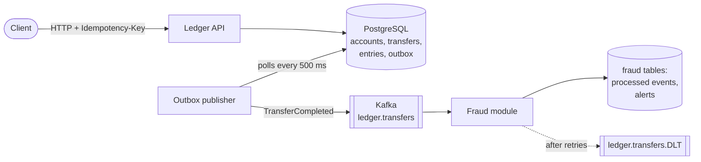

# PayLedger

[](https://github.com/yeldos13/PayLedger/actions/workflows/ci.yml)

A small payments service with a double-entry ledger. You open accounts, top them up and move money
between them. Every completed transfer is announced to Kafka as a `TransferCompleted` event, and a
separate fraud module reads those events and flags suspicious payments.

Built with Java 21, Spring Boot 4, PostgreSQL, Kafka, Flyway and Testcontainers.

## How it works



1. A transfer request comes in with an `Idempotency-Key` header.
2. In **one database transaction** the service checks the balance, moves the money, writes two ledger
   entries and adds an event row to the `outbox` table.
3. A background publisher reads new outbox rows and sends them to Kafka, then marks them as published.
4. The fraud module consumes the event, skips it if it has seen it before, runs its rules and stores an
   alert if one fires.

## Key ideas, in plain words

- **Double-entry ledger.** Money is never created or lost. Each transfer writes two entries: minus on the
  sender, plus on the receiver, so all entries always add up to zero. Deposits come from a system funding
  account per currency (KZT, USD, EUR), which is the only account allowed to go negative.
- **Amounts are whole numbers** in minor units (tiyn, cents) stored as `long`. No floating point.
- **No double spending.** Accounts use optimistic locking (`@Version`). If two transfers touch the same
  account at once, one of them retries with fresh balances. A database `CHECK` keeps customer balances
  at zero or above as a last line of defence.
- **Safe retries.** Every payment needs an `Idempotency-Key`. Sending the same request again returns the
  original transfer instead of charging twice. Reusing a key for a different request is rejected.
- **Transactional outbox.** The event is saved in the same transaction as the transfer, so an event exists
  if and only if the money moved. Kafka delivery is at least once; consumers dedupe by the `eventId` header.
- **Clear errors.** Failures follow RFC 9457 Problem Details (`application/problem+json`):
  422 for broken business rules, 404 for unknown accounts, 409 for a conflict that survived retries.
- **Structured logs** in JSON (Elastic Common Schema), ready for Loki or ELK.

## Fraud module

Lives in the same application but behaves like a separate service: it only knows the ledger through
Kafka events and has its own tables. A [Spring Modulith](https://spring.io/projects/spring-modulith) test
fails the build if it ever imports ledger code.

- **Each event handled once.** Kafka may deliver an event again, so the module records every `eventId` in
  the same transaction as its work and skips repeats.
- **Rules.** `LARGE_AMOUNT`: 500 000 KZT or 1 000 USD/EUR and above. `VELOCITY`: 5 or more incoming payments
  to one account within a minute, a typical money-mule pattern. A rule only raises an alert for review;
  it never blocks the payment.
- **Bad messages don't block the queue.** A failing event is retried twice, then moved to
  `ledger.transfers.DLT`. Malformed JSON goes there at once, since retrying cannot fix it.

> **Demo only:** there is no authentication, so anyone who can reach the API can top up any account.

## Run it

You need Docker.

```bash
docker compose up -d --build
```

This starts PostgreSQL, Kafka and the app on http://localhost:8080.

- Swagger UI: http://localhost:8080/swagger-ui.html
- Health: http://localhost:8080/actuator/health

To run the app from your IDE instead, start only the infrastructure with
`docker compose up -d postgres kafka` and run `PayLedgerApplication`.

## Try it

```bash
# open two accounts
curl -s -X POST localhost:8080/accounts -H 'Content-Type: application/json' -d '{"currency":"KZT"}'
curl -s -X POST localhost:8080/accounts -H 'Content-Type: application/json' -d '{"currency":"KZT"}'

# top up the first one (amount in tiyn)
curl -s -X POST localhost:8080/accounts/<alice-id>/deposits \
  -H 'Content-Type: application/json' -H 'Idempotency-Key: dep-1' -d '{"amount":10000}'

# send 2500 to the second one; repeating this exact call returns the same transfer
curl -s -X POST localhost:8080/transfers \
  -H 'Content-Type: application/json' -H 'Idempotency-Key: pay-1' \
  -d '{"fromAccountId":"<alice-id>","toAccountId":"<bob-id>","amount":2500}'

# balance and statement
curl -s localhost:8080/accounts/<alice-id>
curl -s localhost:8080/accounts/<alice-id>/entries
```

Watch the events arrive in Kafka:

```bash
docker compose exec kafka /opt/kafka/bin/kafka-console-consumer.sh \
  --bootstrap-server localhost:9092 --topic ledger.transfers --from-beginning
```

## API

| Method | Path | What it does |
|---|---|---|
| POST | `/accounts` | Open an account in a currency |
| GET | `/accounts/{id}` | Account with its balance |
| GET | `/accounts/{id}/entries` | Statement, newest first |
| POST | `/accounts/{id}/deposits` | Top up from the system account (needs `Idempotency-Key`) |
| POST | `/transfers` | Move money between two customer accounts (needs `Idempotency-Key`) |
| GET | `/transfers/{id}` | One transfer |

## Tests

```bash
./mvnw verify
```

Needs Docker: integration tests run against real PostgreSQL and Kafka through Testcontainers.
They cover parallel transfers that try to overdraw an account, concurrent retries with the same key,
the full HTTP → database → Kafka flow, the ledger invariant that all entries sum to zero, fraud alerts
raised from real Kafka events, the dead letter topic, and module boundaries.
CI runs the same command on every push.

## Project layout

```
src/main/java/dev/sozakbay/payledger/
├── ledger/   accounts, transfers, entries, REST API, outbox publisher
├── fraud/    Kafka listener, deduplication, rules, dead letter topic
└── events/   TransferCompleted, the JSON contract between the two
src/main/resources/db/migration/   Flyway SQL migrations
```
